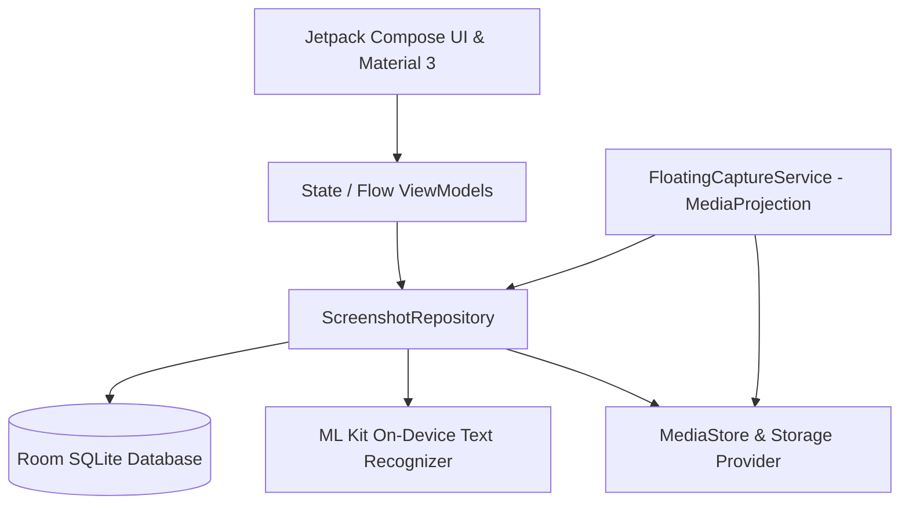

# SnapSort 📸

[](https://developer.android.com)
[](https://kotlinlang.org)
[](https://developer.android.com/jetpack/compose)
[](https://developers.google.com/ml-kit)
[](LICENSE)

**SnapSort** is a modern, privacy-first Android application designed to effortlessly capture, categorize, and extract text from screenshots. Built with 100% on-device processing, SnapSort requires no cloud accounts, no network connectivity, and zero telemetry.

---

## 🌟 Key Features

- **⚡ Floating Quick-Capture**: An unobtrusive floating overlay button using Android's `MediaProjection` API for instant screen captures from any app without physical buttons.
- **🗂️ Smart Collection Manager**: Organize screenshots into custom or default categories (Finance, Work, Recipes, Shopping, etc.) with multi-select batch moving and deletion.
- **🔍 100% Offline OCR**: Lightning-fast text extraction powered by Google ML Kit Text Recognition v2 running entirely on the device.
- **📝 Interactive Text Block Selection**:
  - Automatically segments recognized text into structured blocks.
  - Multi-block selection for quick bulk copying.
  - Granular native selection (`SelectionContainer`) to highlight and copy specific words or phrases.
  - Quick actions for clipboard copy and web search.
- **🔄 Automatic Device Sync**: Automatically identifies and indexes existing screenshots from your device's media storage.

---

## 🏗️ Architecture & Technology Stack

SnapSort is engineered following clean architecture and modern Android development best practices:



### Core Technologies
- **Language**: Kotlin 1.9.22 (Coroutines, Flow, StateFlow)
- **UI Toolkit**: Jetpack Compose with Material 3 design system
- **Local Persistence**: AndroidX Room 2.6.1 with KSP (Kotlin Symbol Processing)
- **Computer Vision**: Google ML Kit Text Recognition v2 (100% on-device)
- **Media Capture**: Android `MediaProjection` & `VirtualDisplay` pipeline
- **Image Pipeline**: Coil Compose 2.6.0 for asynchronous image rendering
- **System Integration**: `SYSTEM_ALERT_WINDOW` & Foreground Services (Android 14 ready)

---

## 📂 Project Structure

```
com.snapsort.app/
├── data/
│   ├── model/         # Room entities (Collections, Screenshots, Text Content)
│   ├── dao/           # Data access objects with reactive Flow queries
│   └── repository/    # Unified repository handling local DB and MediaStore sync
├── ocr/
│   └── OcrScanner.kt  # On-device ML Kit image-to-text pipeline
├── service/
│   ├── FloatingCaptureService.kt  # WindowManager overlay & screen capture engine
│   └── RequestCaptureActivity.kt  # Permission handler for MediaProjection
└── ui/
    ├── components/    # Reusable Compose widgets (cards, search bars, sheets)
    ├── screens/       # Core app screens (Home, Detail Viewer, Search, Settings)
    └── theme/         # Color palettes, typography, and Material 3 theme
```

---

## 🚀 Getting Started

### Prerequisites
- Android Studio Hedgehog (2023.1.1) or newer
- JDK 17 or JDK 21
- Android SDK 34 (API Level 34)
- Physical device or emulator running Android 8.0 (API 26) or higher

### Building from Source

1. Clone the repository:
   ```bash
   git clone https://github.com/your-username/snapsort.git
   cd snapsort
   ```

2. Open the project in Android Studio, or build the debug APK via Gradle:
   ```bash
   ./gradlew assembleDebug
   ```

3. The generated APK will be located at:
   ```
   app/build/outputs/apk/debug/app-debug.apk
   ```

---

## 🔒 Privacy & Permissions

SnapSort respects user privacy above all else:
- **Zero Network Traffic**: The app contains no remote analytics, third-party trackers, or cloud upload mechanisms.
- **Media & Storage (`READ_MEDIA_IMAGES` / `READ_EXTERNAL_STORAGE`)**: Used solely to scan and organize screenshots locally.
- **Display Over Other Apps (`SYSTEM_ALERT_WINDOW`)**: Required only if the floating capture button feature is enabled.
- **Screen Recording (`MEDIA_PROJECTION`)**: Used on-demand solely when taking a screenshot via the floating button.

---

## 📄 License

This project is licensed under the MIT License - see the [LICENSE](LICENSE) file for details.
