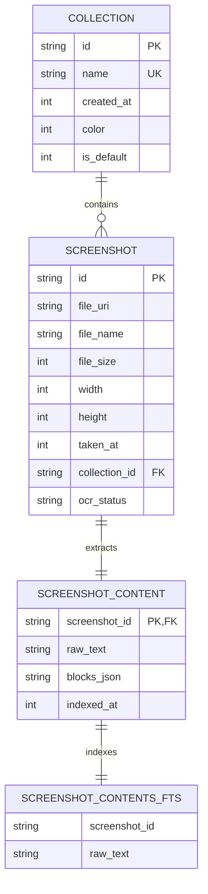
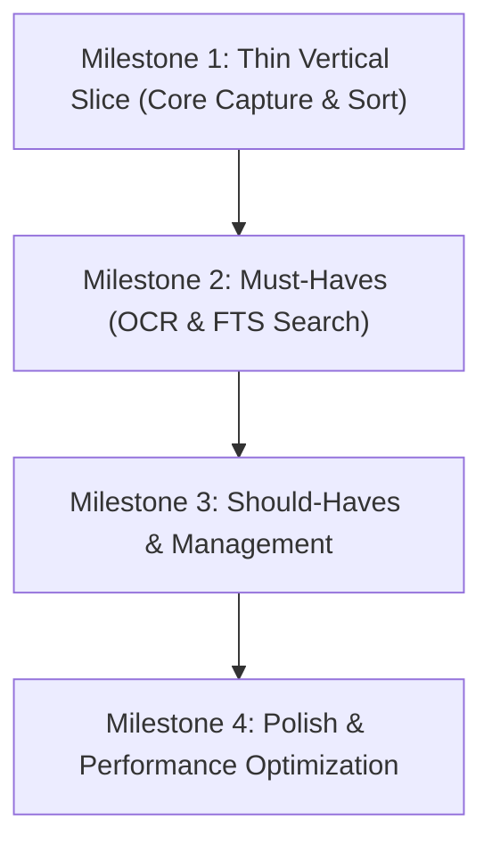

# Architecture: SnapSort (Rebuild of Firefox ScreenshotGo)

A clean-room, privacy-first, 100% on-device Android screenshot organizer with floating capture, instant sorting, and on-device OCR text search.

---

## 1. Stack

| Layer | Choice | Why |
|---|---|---|
| **Mobile App & UI** | Kotlin + Jetpack Compose (Material 3) | Modern native Android stack; simplifies dynamic overlay views, reactive state, and declarative UI with zero legacy XML overhead. |
| **Local Database** | SQLite via AndroidX Room + FTS5 | Exact match for the inferred schema; zero server cost, instant local transactions, and sub-millisecond full-text search indexing across tens of thousands of screenshots. |
| **OCR / Text Recognition** | Google ML Kit Text Recognition v2 (`play-services-mlkit-text-recognition`) | Runs 100% offline on-device, zero latency, free, high accuracy across Latin & Asian scripts, without sending user data to external servers. |
| **Background Processing** | AndroidX WorkManager + Coroutines Flow | Handles batch OCR scanning and gallery indexing reliably even when the app is in background or device restarts, respecting battery/charging constraints. |
| **Screen Capture Engine** | Android `MediaProjection` API + `ImageReader` | Official, secure Android API to capture high-fidelity screen buffers with explicit user consent. |
| **Floating Action Button** | Android `WindowManager` + `SYSTEM_ALERT_WINDOW` Foreground Service | Enables the persistent edge-snapping "GO" capture button over any third-party app with low memory footprint. |
| **Image Storage & Scoped Access** | Android `MediaStore.Images` API | Compliant with Android 10+ Scoped Storage rules; allows saving new screenshots cleanly to the device's Pictures/Screenshots folder and deleting files cleanly. |
| **Image Loading & Caching** | Coil 3 (Kotlin Coroutines Image Loader) | Fast, modern, lightweight Compose-native image loader with memory caching and automatic thumbnail downsampling. |

---

## 2. Schema

Tables: **3 core tables + 1 FTS5 virtual table**.  
Access rules: **Local-First Data Layer Checks**. Room DAO interface acts as the strict authorization boundary; no network/multi-tenant exposure.

Full DDL is maintained in [`replica/schema.sql`](file:///d:/APPS/Screenshoot%20Go/replica/schema.sql).

### Visual ER Diagram

### Key Database Guarantees
- **Cascading Deletions**: Deleting a screenshot record automatically purges its OCR text (`screenshot_contents`) and removes it from the full-text search index (`screenshot_contents_fts`) via SQLite triggers.
- **Safe Fallback**: If a custom collection is deleted, associated screenshots fall back to `'default_unsorted'` (`ON DELETE SET DEFAULT`).
- **Sub-millisecond Search**: Full-text queries execute via `MATCH` on the FTS5 virtual table rather than expensive `LIKE '%query%'` scans.

---

## 3. Data Layer API & System Contracts

Because SnapSort is an offline, local-first application, the API is defined as Kotlin Repository interfaces and Android Intent contracts mapped directly to each flow from the recon map.

### Repository Operations by Flow

| Interface Method | Does | Caller / Trigger | Input | Output | Flow |
|---|---|---|---|---|---|
| `CaptureService.takeScreenshot()` | Captures current display buffer | Floating GO button tap (S05) | `MediaProjection` session | `Bitmap` in memory | **F01** |
| `ScreenshotRepository.saveScreenshot()` | Writes bitmap to disk & registers in DB | Sorting Panel (S06) or Auto-save | `Bitmap`, `targetCollectionId` | `Screenshot` record | **F01** |
| `CollectionRepository.getCollections()` | Emits list of collections with item counts | S02 Home / S06 Sorting Panel | None | `Flow<List<CollectionWithCount>>` | **F01, F04** |
| `OcrScanner.recognizeText(uri)` | Runs ML Kit OCR on image bitmap | Background worker / Detail Page (S04) | Image URI | `OcrResult` (text + bounding boxes) | **F02** |
| `ScreenshotRepository.searchByText()` | Queries FTS5 index for matching keywords | Search Screen (S07) | `query: String` | `Flow<List<Screenshot>>` | **F03** |
| `CollectionRepository.createCollection()` | Inserts new category | S08 Modal Dialog | `name: String, color: Int` | `Collection` record | **F04** |
| `ScreenshotRepository.moveScreenshots()` | Batch updates collection foreign key | S03 Multi-select action | `ids: List<String>, targetId: String` | `Int` (rows modified) | **F05** |
| `ScreenshotRepository.deleteScreenshots()` | Removes files from disk & deletes DB rows | S03 / S04 Delete action | `ids: List<String>` | `Boolean` | **F05** |

### Background Jobs (AndroidX WorkManager)

| Job Name | Schedule / Trigger | Constraints | Description |
|---|---|---|---|
| `OcrIndexingWorker` | One-time per new capture, or batched when idle | Battery not low | Extracts text from pending screenshots using ML Kit and populates `screenshot_contents` + FTS index. |
| `GallerySyncWorker` | Periodic (every 6 hours) or on app resume | Idle state | Scans the system `Pictures/Screenshots` folder for screenshots captured via hardware keys (Power+VolDown) and imports them into "Unsorted". |

### External Android Intents & System Contracts

- **Capture Permission Intent**: `MediaProjectionManager.createScreenCaptureIntent()` -> Launches system screen recording consent.
- **Overlay Permission Intent**: `Settings.ACTION_MANAGE_OVERLAY_PERMISSION` -> Prompts user to allow drawing over other apps.
- **Share Intent**: `Intent.ACTION_SEND` (MIME: `image/*` or `text/plain`) -> Android native share sheet.
- **Web Search Intent**: `Intent.ACTION_WEB_SEARCH` with `SearchManager.QUERY` -> Dispatches search query to default browser.

---

## 4. The Parts That Bite (Risk & Mitigation)

- **Android 14+ MediaProjection Constraints**:
  - *Risk*: Android 14 requires specifying `FOREGROUND_SERVICE_TYPE_MEDIA_PROJECTION` in the manifest and passing the projection token strictly from an active foreground activity.
  - *Mitigation*: Start `CaptureService` with a transparent helper activity (`RequestCaptureActivity`) that requests projection approval and immediately binds the service.
- **Manufacturer-Specific Overlay Killing (Xiaomi MIUI / Samsung OneUI / ColorOS)**:
  - *Risk*: Aggressive battery managers terminate background overlay services and reset floating button positions.
  - *Mitigation*: Provide an in-app setup guide with direct intent links to "Autostart" and "Ignore Battery Optimization" settings.
- **Scoped Storage File Deletions (Android 11+)**:
  - *Risk*: Applications cannot delete files in `MediaStore` created by other apps or system screenshots without showing a system confirmation dialog (`MediaStore.createDeleteRequest`).
  - *Mitigation*: Implement standard `ActivityResultLauncher` handling for `IntentSender` returned by `createDeleteRequest`.
- **Battery & Thermal Throttling during Bulk OCR Indexing**:
  - *Risk*: Running OCR on 1,000 existing screenshots simultaneously will overheat the phone and drain battery.
  - *Mitigation*: Process at most 3 images per batch in `OcrIndexingWorker`, prioritizing on-demand OCR for the active screen (S04) before queuing remaining items.
- **Out of Memory (OOM) with High-Res Displays**:
  - *Risk*: Loading multiple 1440p / 4K screenshots into memory will crash the VM.
  - *Mitigation*: Coil handles automatic downsampling (`BitmapFactory.Options.inSampleSize`) for grid thumbnails; full bitmaps are only loaded in S04 with hardware bitmap configuration (`Bitmap.Config.HARDWARE`).

---

## 5. Build Order

### Milestone 1: Thin Vertical Slice (Core Capture Loop)
- **Goal**: User can tap floating button over any app, capture screen, pick a collection on popup panel, and view it in home feed.
- **Screens**: S05 (Floating GO Button), S06 (Sorting Panel), S02 (Home feed list).
- **Tables**: `collections`, `screenshots`.
- **Key Classes**: `FloatingCaptureService`, `SortingPanelDialog`, `ScreenshotRepository`.

### Milestone 2: Must-Haves (On-Device OCR & Full-Text Search)
- **Goal**: Screenshots automatically have text extracted locally; user can search any word or open full image to copy text.
- **Screens**: S04 (Detail & OCR Viewer), S07 (Full-Text Search), S08 (Create Collection Dialog).
- **Tables**: `screenshot_contents`, `screenshot_contents_fts`.
- **Key Classes**: `OcrScanner`, `OcrIndexingWorker`, `DetailViewModel`, `SearchViewModel`.

### Milestone 3: Should-Haves & Management
- **Goal**: Full collections management, multi-select batch operations, web search from text, settings toggles.
- **Screens**: S03 (Collection Detail with multi-select), S09 (Info modals), S10 (Settings).
- **Key Classes**: `BatchActionHandler`, `SettingsRepository`, `CollectionDetailViewModel`.

### Milestone 4: Polish & Ecosystem Integration
- **Goal**: Background gallery synchronization (detect screenshots taken via hardware keys), edge-snapping physics, and battery optimizations.
- **Key Classes**: `GallerySyncWorker`, `FloatingButtonGestureDetector`.
